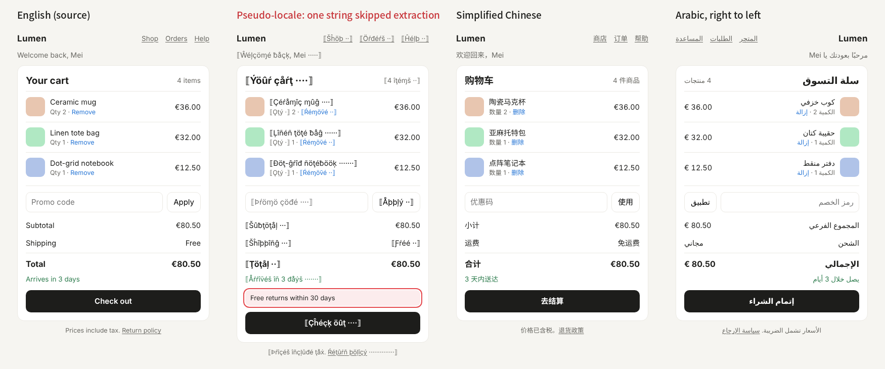
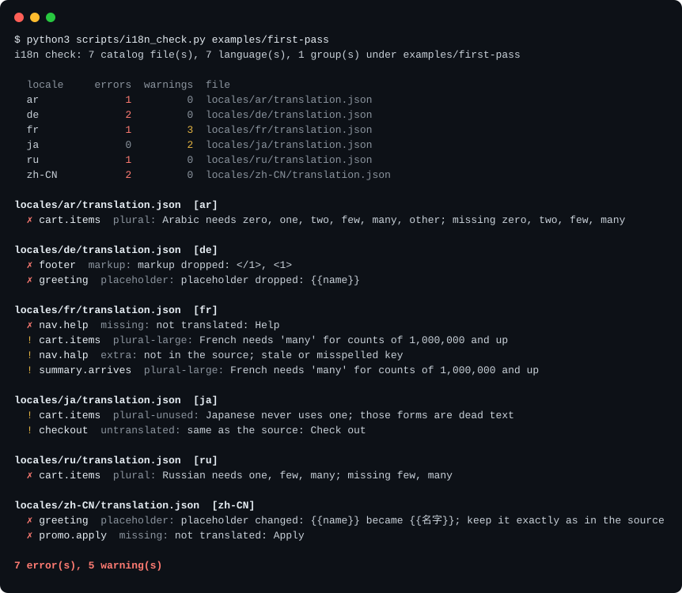

# i18n-anything

**Translate any app into any language with your coding agent, and prove nothing was missed.**

English · [简体中文](README.zh-CN.md)



Coding agents are good at translating interface text and bad at the bookkeeping around it. Ask
one to add five languages and you get a confident "done", plus:

- strings still hardcoded in components it never opened,
- `{{name}}` translated into `{{名字}}`, or dropped,
- English `one`/`other` plural forms copied into Russian (which needs three forms for whole
  numbers), Polish and Arabic (which needs six),
- `<1>…</1>` tags lost, so a link disappears,
- "Check out" left in English in the Japanese file.

i18n-anything is an Agent Skill for Claude Code, Codex and any agent that reads `SKILL.md`. It
gives the agent a workflow (extract, prove, translate, verify) and three scripts that check the
bookkeeping, so "done" comes with evidence. The scripts need only Python 3.10+, no packages.

## Install

```bash
git clone https://github.com/DU8866-nice/i18n-anything
cp -r i18n-anything/skills/i18n-anything ~/.claude/skills/     # Claude Code
# Codex and other agents that read SKILL.md: copy the folder into that agent's skills directory
```

Then ask: *"Translate this app into German, Japanese and Arabic."*

## What the checker catches

Here is an agent's first pass at the demo shop's six languages. Each line is a bug a user would
see:



After fixing them, the same command prints `✓ no problems` for [`examples/shop`](examples/shop).
The scripts:

| Script | Job |
|---|---|
| [`i18n_check.py`](skills/i18n-anything/scripts/i18n_check.py) `[ROOT]` | Finds every catalog and compares each language with the source: missing keys, empty strings, placeholders dropped, invented or changed (`%s` and `%1$s` count as the same), markup tags, plural forms the language needs under CLDR 48, ICU plurals without `other`, fuzzy gettext entries, text left in the source language or in the wrong script, stale keys. Exit code 1 on errors, so it works in CI. |
| [`find_strings.py`](skills/i18n-anything/scripts/find_strings.py) `[ROOT]` | Lists user-facing text still hardcoded in JSX/TSX, Vue, Svelte, Astro, HTML, JS DOM code, Android layouts, Jetpack Compose, UIKit and Flutter. |
| [`pseudo.py`](skills/i18n-anything/scripts/pseudo.py) `CATALOG` | Writes an `en-XA` pseudo-locale, "⟦Šåṽé çĥåñĝéš ···⟧", 40% longer with brackets, keeping placeholders, tags and ICU syntax intact. `--rtl` writes a right-to-left `ar-XB`. |

And [`pseudo-highlight.js`](skills/i18n-anything/assets/pseudo-highlight.js): run it in the page
while the app is in the pseudo-locale, and it outlines every piece of text that didn't come
through the translation function (the red box in the second panel above). That catches strings
built at runtime, which no static scan sees.

## Tried on a real project

[Excalidraw](https://github.com/excalidraw/excalidraw) ships 52 languages. Run against commit
`542ad76` (24 Nov 2026), `i18n_check.py` read all 53 catalogs in under a second and found 29
broken placeholders and tags in six languages, each confirmed by reading the files:

- Spanish has `{{mix}}` where English has `{{max}}`. Excalidraw only replaces `{{max}}`, so
  Spanish users see the literal text `{{mix}}` instead of the character limit.
- Arabic and Hebrew dropped the `<link>` in "You can track the status here", so the link is gone.
- Persian has `<link/> … <link>` instead of `<link>…</link>`.
- Sinhala lost `{{maxSize}}`, `{{count}}`, `{{authorName}}` and a dozen links and bold tags.

It also lists 7,436 strings that are empty in some language (Excalidraw falls back to English for
those), so the errors are easy to filter: `--json` and pick the `placeholder` and `markup` codes.

## The workflow

The full version is in [`SKILL.md`](skills/i18n-anything/SKILL.md).

1. **Take stock**: stack, existing library, source and target languages.
2. **Set up the library** if there is none: the platform's standard, never a hand-rolled one
   ([which one](skills/i18n-anything/references/libraries.md)).
3. **Extract** with `find_strings.py`: whole sentences, never fragments glued together; plurals
   and numbers through the library.
4. **Prove the extraction** with the pseudo-locale and the highlighter, screen by screen, until
   nothing is outlined. The 40% padding shows where German will overflow.
5. **Translate** with a fixed register per language (*du* or *Sie*), a glossary, placeholders
   copied exactly, every plural form the language needs, and its own punctuation
   ([guide](skills/i18n-anything/references/translation.md)).
6. **Verify** with `i18n_check.py` until 0 errors, then screenshots, including right to left
   ([layout](skills/i18n-anything/references/layout.md)).
7. **Report**, and say plainly that machine translation is a draft for a native speaker to
   review.

## Formats

| Format | Used by | Plurals checked |
|---|---|---|
| JSON, nested or flat | i18next, react-i18next, next-intl, vue-i18n, FormatJS, svelte-i18n | `_one`/`_few`/`_many` suffixes, ICU |
| ARB | Flutter `gen-l10n` | ICU |
| `_locales/*/messages.json` | Chrome extensions | `$NAME$` placeholders |
| `.xcstrings`, `.strings` | iOS, macOS | String Catalog variations |
| `.po`, `.pot` | gettext: Django, Flask, Babel, WordPress, C | `msgstr[n]` and the `Plural-Forms` header |
| `res/values*/strings.xml` | Android | `<plurals>` |
| `.properties` | Java, Spring | none |

Catalogs are found by their usual paths (`locales/de/…`, `messages/de.json`, `app_de.arb`,
`de.lproj/`, `values-de/`, `locale/de/LC_MESSAGES/`, `messages_de.properties`). Not read yet:
XLIFF (Angular), YAML (Rails), `.stringsdict`, and vue-i18n's `car | cars` pipe plurals, which are
compared as plain text.

## Plural rules

The plural table comes from CLDR 48 via `Intl.PluralRules` and covers 77 languages. For each one
it separates the forms whole numbers need (errors if missing) from forms only a million or more
needs, like French `many` (warnings), and forms only decimals need, like Russian `other`
(warnings). A test compares the table with the ICU on the machine running it.

## Try the demo

```bash
python3 -m http.server 8000      # from the repo root
```

Then open `http://localhost:8000/examples/shop/?lang=ar` (or `de`, `fr`, `ja`, `ru`, `zh-CN`), and
`?lang=en-XA&missed=1&highlight=1` to see the highlighter catch a hardcoded string.
[`examples/before/Cart.jsx`](examples/before/Cart.jsx) is the same cart before extraction, for
`find_strings.py`.

## Limits

- The scripts check structure, not quality. A fluent, wrong translation passes. That's what the
  native-speaker review in step 7 is for.
- `find_strings.py` is a regex scan. It misses strings built in code and flags the odd log line;
  the pseudo-locale is the real test.
- Formats not listed above need checking by hand.

## Contributing

Bug reports with a small catalog that reproduces them are the most useful thing. See
[CONTRIBUTING.md](CONTRIBUTING.md).

## License

[MIT](LICENSE)
