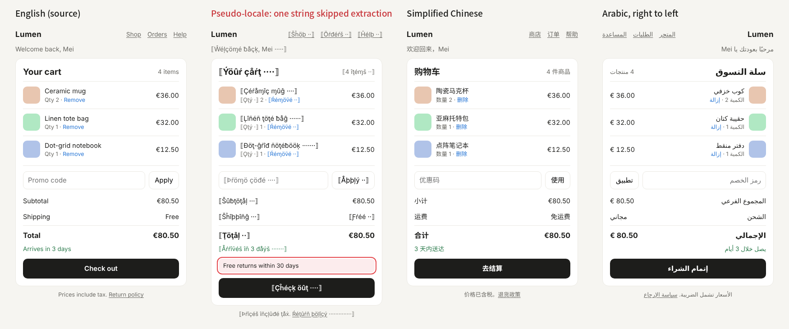
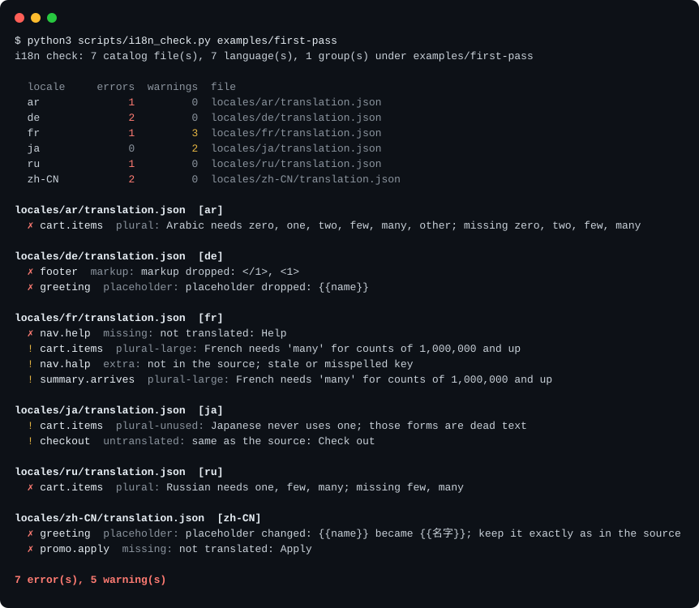

# i18n-anything

**让编程 Agent 把任何应用翻译成任何语言，并证明一个都没漏。**

[English](README.md) · 简体中文



编程 Agent 翻译界面文字很快，但围绕翻译的「记账」工作经常出错。让它加五种语言，它会很自信地说「完成了」，
实际上却留下这些问题：

- 它没打开过的组件里，字符串还是硬编码的；
- `{{name}}` 被翻译成 `{{名字}}`，或者干脆丢了；
- 把英文的 `one`/`other` 两种复数形式照搬到俄语（整数就要三种）、波兰语和阿拉伯语（要六种）；
- `<1>…</1>` 标签丢了，链接跟着消失；
- 日文文件里还留着英文的 “Check out”。

i18n-anything 是一个 Agent Skill，适用于 Claude Code、Codex 以及任何读取 `SKILL.md` 的 Agent。它给 Agent
一套流程（提取 → 证明 → 翻译 → 验证），外加三个检查脚本，让「完成了」有证据可查。脚本只需要
Python 3.10+，不用装任何包。

## 安装

```bash
git clone https://github.com/DU8866-nice/i18n-anything
cp -r i18n-anything/skills/i18n-anything ~/.claude/skills/     # Claude Code
# Codex 等读取 SKILL.md 的 Agent：把这个文件夹复制到对应的 skills 目录
```

然后对 Agent 说：「把这个应用翻译成德语、日语和阿拉伯语。」

## 检查器能发现什么

下面是 Agent 第一次翻译演示商店六种语言的结果，每一行都是用户会看到的 bug：



修好之后，同一条命令对 [`examples/shop`](examples/shop) 输出 `✓ no problems`。三个脚本：

| 脚本 | 作用 |
|---|---|
| [`i18n_check.py`](skills/i18n-anything/scripts/i18n_check.py) `[目录]` | 找出所有语言文件，逐个和源语言比对：缺失的 key、空字符串、被删掉、凭空多出或改名的占位符（`%s` 和 `%1$s` 视为同一个）、标签、按 CLDR 48 该语言需要的复数形式、没有 `other` 分支的 ICU 复数、gettext 的 fuzzy 条目、没翻译或文字系统不对的文本、过期的 key。有错误时退出码为 1，可以直接放进 CI。 |
| [`find_strings.py`](skills/i18n-anything/scripts/find_strings.py) `[目录]` | 列出 JSX/TSX、Vue、Svelte、Astro、HTML、JS DOM 代码、Android 布局、Jetpack Compose、UIKit 和 Flutter 里仍然硬编码的界面文字。 |
| [`pseudo.py`](skills/i18n-anything/scripts/pseudo.py) `语言文件` | 生成 `en-XA` 伪本地化文件，如「⟦Šåṽé çĥåñĝéš ···⟧」：加长 40%、带括号，占位符、标签和 ICU 语法保持不变。加 `--rtl` 生成从右到左的 `ar-XB`。 |

还有 [`pseudo-highlight.js`](skills/i18n-anything/assets/pseudo-highlight.js)：应用切到伪本地化后在页面里
运行它，所有没经过翻译函数的文字都会被红框标出来（上图第二栏）。运行时拼出来的字符串，静态扫描看不到，
它能看到。

## 在真实项目上试了一下

[Excalidraw](https://github.com/excalidraw/excalidraw) 支持 52 种语言。在 `542ad76`（2026 年 11 月 24 日）这个提交上，
`i18n_check.py` 不到一秒读完 53 个语言文件，在六种语言里找到 29 处坏掉的占位符和标签，每一处我都对照文件确认过：

- 西班牙语把英文的 `{{max}}` 写成了 `{{mix}}`。Excalidraw 只替换 `{{max}}`，所以西班牙语用户看到的是字面上的 `{{mix}}`，而不是字数上限。
- 阿拉伯语和希伯来语把「You can track the status here」里的 `<link>` 删了，链接跟着没了。
- 波斯语写成了 `<link/> … <link>`，而不是 `<link>…</link>`。
- 僧伽罗语丢了 `{{maxSize}}`、`{{count}}`、`{{authorName}}`，还有十几个链接和加粗标签。

它还列出了 7436 条在某些语言里为空的字符串（Excalidraw 遇到空字符串会回退到英文），所以想只看错误的话，
用 `--json` 输出，再筛 `placeholder` 和 `markup` 两类即可。

## 流程

完整版见 [`SKILL.md`](skills/i18n-anything/SKILL.md)。

1. **摸底**：技术栈、现有的 i18n 库、源语言和目标语言。
2. **没有库就先装**：用平台标准方案，不要自己写（[各平台选什么](skills/i18n-anything/references/libraries.md)）。
3. **提取**：用 `find_strings.py`。整句提取，不要拼接碎片；复数和数字交给库处理。
4. **证明提取完整**：逐个页面跑伪本地化和高亮脚本，直到没有红框。40% 的加长会提前暴露德语会溢出的位置。
5. **翻译**：每种语言固定语体（德语用 *du* 还是 *Sie*）、维护术语表、占位符原样保留、写全该语言需要的
   复数形式、使用该语言的标点（[翻译指南](skills/i18n-anything/references/translation.md)）。
6. **验证**：`i18n_check.py` 跑到 0 错误，再截图检查，包括从右到左的排版
   （[排版](skills/i18n-anything/references/layout.md)）。
7. **汇报**：并明确说明机器翻译只是初稿，需要母语者审校。

## 支持的格式

| 格式 | 使用方 | 复数检查 |
|---|---|---|
| JSON（嵌套或扁平） | i18next、react-i18next、next-intl、vue-i18n、FormatJS、svelte-i18n | `_one`/`_few`/`_many` 后缀、ICU |
| ARB | Flutter `gen-l10n` | ICU |
| `_locales/*/messages.json` | Chrome 扩展 | `$NAME$` 占位符 |
| `.xcstrings`、`.strings` | iOS、macOS | String Catalog 变体 |
| `.po`、`.pot` | gettext：Django、Flask、Babel、WordPress、C | `msgstr[n]` 和 `Plural-Forms` 头 |
| `res/values*/strings.xml` | Android | `<plurals>` |
| `.properties` | Java、Spring | 无 |

语言文件按常见路径自动识别（`locales/de/…`、`messages/de.json`、`app_de.arb`、`de.lproj/`、`values-de/`、
`locale/de/LC_MESSAGES/`、`messages_de.properties`）。暂不支持：XLIFF（Angular）、YAML（Rails）、`.stringsdict`，
以及 vue-i18n 的 `car | cars` 管道式复数（按普通文本比较）。

## 复数规则

复数表来自 CLDR 48（通过 `Intl.PluralRules` 生成），覆盖 77 种语言。每种语言分三类：整数需要的形式（缺了
报错）、只有一百万以上才用到的形式，比如法语的 `many`（警告）、只有小数才用到的形式，比如俄语的 `other`
（警告）。有一个测试会把这张表和运行机器上的 ICU 对比。

## 试试演示

```bash
python3 -m http.server 8000      # 在仓库根目录运行
```

打开 `http://localhost:8000/examples/shop/?lang=ar`（也可以是 `de`、`fr`、`ja`、`ru`、`zh-CN`），
或者 `?lang=en-XA&missed=1&highlight=1` 看高亮脚本抓出一个硬编码字符串。
[`examples/before/Cart.jsx`](examples/before/Cart.jsx) 是提取之前的同一个购物车，用来试 `find_strings.py`。

## 局限

- 脚本检查的是结构，不是翻译质量。通顺但译错的句子能通过检查，所以第 7 步需要母语者审校。
- `find_strings.py` 是正则扫描，会漏掉代码里拼出来的字符串，也会误报个别日志文本；真正的检验是伪本地化。
- 上表之外的格式需要人工检查。

## 参与贡献

最有用的是附带一个能复现问题的小语言文件的 bug 报告。详见 [CONTRIBUTING.md](CONTRIBUTING.md)。

## 许可证

[MIT](LICENSE)
